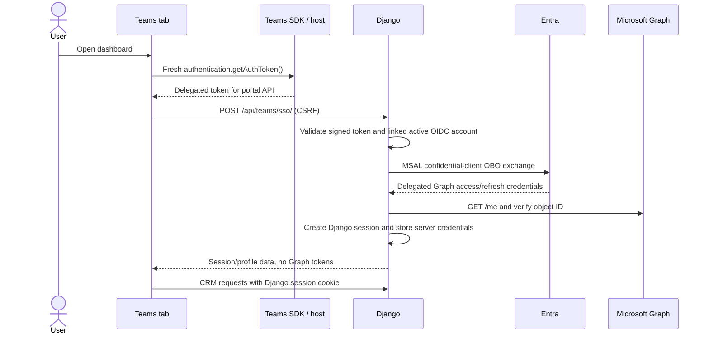

# Teams sign-in and Microsoft Graph

Contacts Portal has three distinct delegated Graph authentication paths:

1. Teams tab SDK/MSAL tokens for direct Graph reads in the personal tab.
2. Server-side OBO for Teams users who open the full dashboard.
3. Server-side OIDC credentials for users signed in through an Entra provider
   in an ordinary browser.

The Teams SSO token targets the portal API, not Microsoft Graph. Django validates
it before returning a verified identity or exchanging it. The portal does not
use application-only Graph access or Graph write permissions.

## Where Graph requests run

All Graph paths below are relative to `https://graph.microsoft.com/v1.0`. Graph
requests are read-only `GET` requests.

| Operation | Teams tab | Ordinary browser Entra OIDC session |
| --- | --- | --- |
| Sign-in identity/profile check: `/me` | Django calls Graph only for OBO during legacy startup or the explicit full-dashboard action | Django obtains delegated tokens through OIDC; profile reads run server-side |
| Bootstrap identity | Verified `oid`/`tid` from `/api/teams/identity/` or `/api/teams/sso/`; no Django Graph-profile bootstrap | Not an SDK bootstrap step |
| SDK identity check: `/me?$select=id` | SDK calls Graph directly and compares the ID with the verified server identity | Not used |
| Profile view: `/me` | SDK calls Graph directly after initialization | Django calls Graph through `/api/profile/` or `/api/graph/profile/` |
| Profile photo: `/me/photo/$value` | SDK HTTP client retrieves a blob directly; the UI uses a temporary object URL | Django proxies it through `/api/graph/picture/` |
| Calendar: `/me/calendarView` | SDK calls Graph directly for up to five events | Django calls Graph through `/api/graph/calendar/` for up to five events |
| Inbox: `/me/mailFolders/inbox/messages` | SDK calls Graph directly for the five latest messages | Django calls Graph through `/api/graph/inbox/` for the five latest messages |
| Presence: `/me/presence` | SDK calls Graph directly on the polling schedule | Django calls Graph through `/api/graph/presence/` |
| Session response profile: `/me` | Only the full dashboard requests Django session responses; Graph-only startup does not | Django reads Graph when generating session responses |
| Token-renewal identity check: `/me` | Django checks the stored object ID during server token renewal, when recorded | Same server-side behavior |

After Teams SDK initialization, the frontend request helper routes Graph/profile
reads through `app.graph.call(...)`. Photo requests use the SDK's
authenticated `app.graph.http` client. These UI reads do not pass through
Django's Graph endpoints. Calendar and inbox are five-item previews: next links
are ignored and there are no page cursors or load-more controls. The full dashboard still uses Django session/profile
responses, which use the server-side Graph client; Graph-only startup never
requests those responses. Profile data in the portal session remains
server-derived.

Portal SSO, Django sessions, logout, and CRM APIs still call Django. CRM calls,
appointments, companies, contacts, and KPIs are database operations, not Graph
requests. Local sign-ins and non-`entraid` providers do not use either Graph
client.

## Teams SSO and server-side OBO

Legacy startup and the explicit **Open full dashboard** action use this flow:



The process is:

1. The tab gets public provider settings from `/api/teams/config/`, initializes
   `@microsoft/teams-js`, and calls `authentication.getAuthToken()`. The
   resulting delegated token targets the portal API.
2. The tab posts the token and selected provider ID to `/api/teams/sso/` with
   the portal's CSRF token.
3. Django validates the token signature, tenant-specific issuer, audience,
   timestamps, tenant, delegated `access_as_user` scope, and authorized Teams
   client. The verified `oid` and `tid` must match an explicitly linked active
   OIDC account. Email and Teams context IDs are not used to link accounts.
4. MSAL's confidential client performs OBO against the verified tenant
   authority, using the configured client ID, server-only client secret, and
   portal token as the user assertion. The Graph scope is
   `https://graph.microsoft.com/.default`; MSAL handles reserved OIDC scopes
   such as `offline_access`.
5. Django calls Graph `/me` with the returned delegated Graph access token and
   requires the Graph object ID to match the verified Teams token's `oid`.
6. Only after validation does Django sign in the linked portal user and store
   Graph credentials, expiry, tenant, and object ID in the server-side session.
   The response has portal session/profile data, not Graph tokens or secrets.

`/api/teams/identity/` uses the same Teams token validation but only returns the
verified object and tenant IDs. It does not create a session, look up a CRM
account, exchange an OBO token, or call Graph. The endpoint is a CSRF-protected,
input-size-limited and rate-limited POST; responses are private/no-store. The
public configuration endpoint exposes no client secret or token.

## Teams Graph views: independent SDK authentication

After Teams token validation, the tab starts a tenant-bound
`@microsoft/teams.client` app using the four delegated read scopes. SDK/MSAL
uses nested app authentication on supported Teams hosts. When silent consent
is unavailable, the tab can request an interactive token through an MSAL popup
and set the returned active account.

The SDK calls Graph `/me?$select=id` directly and compares it with the verified
Teams identity before exposing any views. Later tab Graph requests use
SDK/MSAL-managed tokens with an in-memory cache. They do not reuse Django's OBO
Graph token, send the portal SSO token to Graph, or perform OBO in browser code.
The SDK has no client secret.

The full dashboard has two separate token paths for the same user: server-side
OBO for Django session/profile work, and SDK/MSAL for direct tab Graph reads.
Graph-only startup uses only the SDK Graph path. Successful portal SSO does not
guarantee SDK consent and vice versa. OBO or SDK initialization/identity failure
prevents the CRM dashboard from opening; after SDK initialization, a Graph read
failure does not silently fall back to Django Graph reads.

## Ordinary browser OIDC and server token renewal

Browser Entra sign-in uses django-allauth's OIDC authorization-code flow, not
the Teams assertion/OBO flow. Django captures delegated Graph access and refresh
credentials in its server-side session. Without an active Teams SDK client,
frontend Graph reads call Django, which attaches the server-held token.

For either type of server Graph session, Django reuses an access token while it
has more than 60 seconds before expiry. Otherwise, MSAL renews it from the
session's serialized token cache. Existing allauth refresh credentials are
imported through MSAL's refresh-token migration API; subsequent renewals use
the cache, including rotated refresh credentials. This renewal is not another
OBO exchange. If an object ID is stored, Django checks `/me` after renewal.

Each server-side cache is bound to the signed-in user, OIDC provider, tenant,
and client ID; it is never shared globally or sent to the browser. Signed-cookie
sessions are rejected for Graph credential storage. Sessions without the
required identity binding, missing refresh credentials, revoked authorization,
or an identity mismatch require the user to sign in again. SDK/MSAL token
management is independent of this server renewal path.

Treat the session database and its backups as credentials: they contain
delegated tokens. Keep Django's server-side session backend and use Django's
`clearsessions` command in operational maintenance to remove expired session
rows.

The server Graph implementation remains required by ordinary browser Graph
views, full-dashboard Teams OBO, and Django session/profile responses. The
Graph-only personal tab does not use it.

## Python SDK boundaries

The backend uses `microsoft-teams-api`, `microsoft-teams-cards`, and
`microsoft-teams-graph` (currently version 2.1.0). Teams API models describe
messaging-extension results and task responses; Teams card models build
Adaptive Cards with Teams-compatible wire aliases. Card version, text escaping,
choice limits, and byte limits remain portal policy.

The bot endpoint retains Bot Framework activity parsing and its channel-JWT
adapter. `microsoft-teams-botbuilder` is not installed: its bridge requires a
`CloudAdapter` and HTTP-server integration rather than wrapping the current
Django `BotFrameworkAdapter`. Switching would be a separate authentication and
error-handling migration. SDK activity unions also impose additional required
fields and known-invoke discriminators, while the current channel parser
preserves existing malformed-request and unsupported-invoke behavior.

`microsoft-teams-graph` supplies the delegated `AuthProvider`; `msgraph-sdk`
supplies request builders and response models for profile, photo, calendar,
inbox, and presence. The SDK uses native HTTPX with its standard middleware,
a ten-second timeout, and disabled retries and redirects. HTTPX event hooks
preserve metadata-only external-call logging through `crm.external_calls`.
A thin adapter maps SDK errors and normalizes responses for the UI.
Calendar and inbox request only five items and never follow `@odata.nextLink`.

MSAL Python handles confidential-client OBO and token renewal. It does not
validate incoming portal access tokens. Teams SSO verifies signatures and
required claims before authorizing a linked active account; Bot Framework
channel authentication is a separate mechanism. SDKs do not implement CRM
permissions: customer access still requires the Agent's company membership and
call-summary updates require that Agent's own call.

Implementation references: [Teams tab](../frontend/src/pages/TeamsTab.tsx),
[Teams Graph client](../frontend/src/teams-graph.ts),
[Teams SSO helpers](../frontend/src/teams.ts),
[Teams backend views](../backend/crm/teams/views.py),
[Teams token/auth helpers](../backend/crm/teams/auth.py),
[Graph client](../backend/crm/graph.py), and
[session signals](../backend/crm/signals.py).

## Entra application registration

Use an Entra confidential web application in the Microsoft public cloud.
Supported OIDC issuers are a tenant UUID or `organizations` at
`https://login.microsoftonline.com`. `common`, consumer accounts, and sovereign
clouds are not supported.

1. Register the portal web redirect URI:
   `https://portal.example.com/accounts/oidc/work/login/callback/` (replace
   `work` with the provider ID). For multitenant sign-in, set supported account
   types to organizational directories and use the `organizations` issuer. For
   a single-tenant app, use that tenant's UUID in the issuer.
2. Create a client secret and keep it only in private deployment settings. Use
   the same Entra client ID for OIDC and the Teams app SSO registration.
3. Under **Expose an API**, set an Application ID URI and expose the delegated
   `access_as_user` scope. Configure the API to issue v2 access tokens
   (`api.requestedAccessTokenVersion: 2`).
4. Preauthorize these Teams clients for `access_as_user`:
   - Desktop/mobile: `1fec8e78-bce4-4aaf-ab1b-5451cc387264`
   - Web: `5e3ce6c0-2b1f-4285-8d4b-75ee78787346`
5. Add Microsoft Graph delegated permissions `User.Read`, `Calendars.Read`,
   `Mail.Read`, and `Presence.Read`, and grant tenant admin consent. Do not add
   application or Graph write permissions. OIDC also requests `openid`,
   `profile`, `email`, and `offline_access`.
6. Add a Single-page application redirect URI for the portal origin, matching
   the SDK redirect URI, and `brk-multihub://portal.example.com` for nested app
   authentication in Teams. Retain the confidential web application's OIDC
   callback and secret for Django. The secret must never be exposed to the
   frontend; use authorization code with PKCE, not implicit token issuance.
7. Users need a Microsoft 365 mailbox and calendar and access to Teams presence.

The Teams token is for the portal API, not Graph. Django validates its RS256
signature using Microsoft's signing keys, issuer, tenant, audience, expiry,
delegated scope, and authorized Teams client. With an `organizations` issuer,
the validated tenant UUID selects the issuer, signing keys, and OBO authority.
Only then does the backend request `https://graph.microsoft.com/.default`.

## OIDC provider configuration

Set `OIDC_PROVIDERS` to a JSON array in private deployment settings. This
example contains placeholders, not credentials:

```json
[
  {
    "id": "entraid-work",
    "name": "Work identity",
    "server_url": "https://login.microsoftonline.com/organizations/v2.0",
    "client_id": "<entra-client-id>",
    "client_secret": "<private-client-secret>",
    "teams": {
      "resource": "api://portal.example.com/botid-<entra-client-id>"
    }
  }
]
```

`teams` is optional; omit it for browser-only Graph integration. Provider IDs
used for Graph must start with `entraid` (case-insensitive). The Teams resource
must exactly match **Expose an API** and `webApplicationInfo.resource` in the
Teams app manifest. The backend accepts either
`api://<portal-host>/<client-id>` or
`api://<portal-host>/botid-<client-id>`; the checked-in Teams app manifests use
the `botid-` form.

| Teams setting | Meaning |
| --- | --- |
| `tenant_id` | Defaults to the OIDC issuer tenant; use `organizations` for a multitenant issuer |
| `resource` | Required Application ID URI, ending in `/<client-id>` or `/botid-<client-id>` |
| `audience` | Defaults to `client_id`; v2 API tokens must use that exact audience |
| `authorized_client_ids` | Optional nonempty UUID array; defaults to the desktop/mobile and web Teams clients above |

An optional provider `scope` array can add OIDC/Graph scopes, but cannot remove
the required read permissions or `offline_access` for an `entraid` provider.
The public Teams configuration endpoint does not expose tokens or client
secrets.

For full-dashboard OBO, each user must first sign in through the same Entra OIDC
provider in a normal browser. This creates the explicit association with the
verified tenant and object ID; email does not link accounts. Administrators
must also provision the user's Agent and company associations for CRM access.
The default Graph-only personal tab does not require a linked CRM account or
Agent. Existing associations without tenant/object claims need a fresh browser
OIDC sign-in. Linking another provider does not enable Graph for an existing
local session; sign in through the Entra provider.

## Further reading

- [Teams tabs](teams-tabs.md)
- [Microsoft Teams tab SSO overview](https://learn.microsoft.com/en-us/microsoftteams/platform/tabs/how-to/authentication/tab-sso-overview)
- [Teams SSO and Graph OBO](https://learn.microsoft.com/en-us/microsoftteams/platform/tabs/how-to/authentication/tab-sso-graph-api)
- [Microsoft 365 Agents Toolkit](https://learn.microsoft.com/en-us/microsoftteams/platform/toolkit/agents-toolkit-fundamentals)
- [Teams JavaScript SDK](https://learn.microsoft.com/en-us/microsoftteams/platform/tabs/how-to/using-teams-client-library)
- [Entra access-token claims](https://learn.microsoft.com/en-us/entra/identity-platform/access-token-claims-reference): a v2 token's `aud` is the API client ID, not its Application ID URI.
