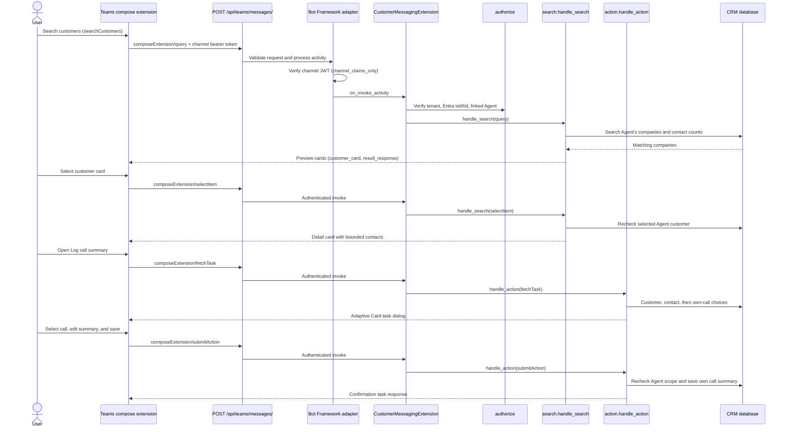

# Customer search and call-summary extension

The Bot Framework app provides two Teams compose commands:

- **Search customers** searches company names among the signed-in Agent's
  customers. Search is case-insensitive, accepts up to 200 characters, and
  returns the page size requested by Teams, up to 25 customers. A preview shows
  the customer name and contact count. Selecting a result shows its ID, contact
  count, and up to 20 contacts. Cards stay within the Teams size limit and note
  when they omit contacts.
- **Log call summary** opens a dialog to choose a customer, one of its contacts,
  and one of the current Agent's calls with that contact. The user can edit and
  save the summary. When available, selected Teams message text is included in
  the editable summary. Saving updates the call's summary. The message and
  summary are each limited to 4,000 characters.

Both commands are limited to the authorized Agent's linked customers and those
customers' contacts. The call-summary action only offers that Agent's calls.
Each choice list shows up to 100 entries. The server checks customer, contact,
and call access again as each step is submitted.

## Authentication and data handling

The endpoint is `POST /api/teams/messages/`. It accepts Bot Framework channel
requests only; browser session cookies do not authorize extension actions.
Each messaging-extension invoke needs a valid channel bearer token and a
linked, active Entra account in the configured tenant. The account must have a
provisioned CRM Agent. Channel-JWT validation happens before
`CustomerMessagingExtension.on_invoke_activity` routes an invoke, and
`authorize` matches the verified tenant and Entra object ID to the linked Agent.

Search and selection query the current Agent's company memberships; they do not
expose the whole shared directory. The call-summary action only permits the
Agent's associated customers, their contacts, and that Agent's own calls.
Submitted customer, contact, and call IDs are rechecked against those
permissions. A browser sign-in or Teams tab SSO session does not authorize the
bot endpoint.

Ordinary bot messages receive “This bot is not enabled for conversation.” The
bot does not process their content, but the request still needs valid Bot
Framework channel authentication.

Cards inserted into a Teams conversation are visible to its participants. They
show the selected customer's data at that time and do not update after portal
changes. Share customer information only with authorized recipients.

## Configure the bot

1. Register a single-tenant Azure Bot, enable the Microsoft Teams channel, and
   set its HTTPS messaging endpoint to
   `https://portal.example.com/api/teams/messages/`.
2. Set these private environment variables:
   - `TEAMS_BOT_APP_ID`: the bot application ID.
   - `TEAMS_BOT_APP_PASSWORD`: the bot client-secret value.
   - `TEAMS_BOT_TENANT_ID`: the allowed Entra tenant UUID.
   - `TEAMS_BOT_PROVIDER_ID`: an `entraid` OIDC provider ID for that tenant.
3. Each user must sign in through that OIDC provider and have a provisioned
   Agent.
4. Configure and package the tabs-and-bot manifest. See
   [App setup and deployment](teams-deployment.md) and the
   [manifest packaging guide](../teams/README.md).

The extension returns HTTP 503 when a required bot setting is missing. It does
not use browser authentication or Graph permissions to authorize bot actions.
The related tab frontend functions in `frontend/src/teams.ts` serve tab SSO and
are not called by this compose extension. Teams renders the extension results
and task dialog.
