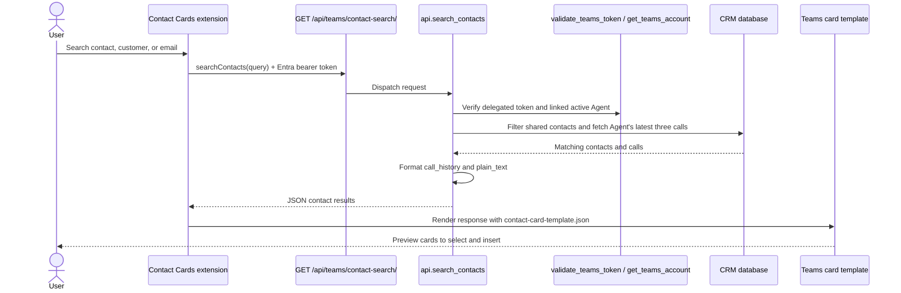

# Contact Cards API extension

The separate **Contact Cards** app uses the Teams API-based messaging
extension. It does not use the Bot Framework endpoint or the portal SPA.

The **Find a contact** command searches the shared directory by customer name,
contact name, or email. A multiword query requires each word to match at least
one of those fields. Searches accept a single non-empty query of up to 200
characters and return up to 25 contacts. Each result shows the contact's name,
email, customer, and up to three of the current Agent's latest calls for that
contact, ordered by newest call ID first. Scheduled calls are included. Call
records can include status, appointment time in UTC, rating, and summary.
Summaries longer than 200 characters are shortened. Contacts without calls
show “No calls recorded.”

Each card is a snapshot of the data when Teams runs the search. Sending or
inserting it shares the contact details and call summaries with everyone in
the conversation, including external participants. Share cards only with
authorized recipients.

## Request flow

## API access

Teams sends a delegated Entra bearer token to
`GET /api/teams/contact-search/?query=...`. The API verifies the token and
matches its tenant and object IDs to one active OIDC account. That account
must have a provisioned Agent. Browser session cookies do not authorize this
endpoint.

Contact search uses the shared directory, not the Agent's customer
memberships. The API returns only the requesting Agent's latest three calls
for each contact. Responses are private and are not cached.

Set `TEAMS_API_PROVIDER_ID` to the configured Entra OIDC provider ID. That
provider must have valid Teams settings. Missing provider configuration
returns HTTP 503; invalid or missing bearer tokens return HTTP 401; users
without a linked active account or provisioned Agent receive HTTP 403. A
missing, repeated, empty, or overlong `query` parameter receives HTTP 400.

## App manifest

The API extension has its own Teams manifest, OpenAPI document, and response
template under `teams/api-extension/`. The manifest declares Microsoft Entra
sign-in with single sign-on and uses `contact-card-template.json` to render
results. Teams calls the documented `GET /api/teams/contact-search/` endpoint
directly; it does not use a bot invoke to select a result.

Keep it in a separate Teams app from the Bot Framework extension: each
manifest can define only one messaging extension. See [App setup and
deployment](teams-deployment.md) and the
[manifest packaging guide](../teams/README.md) for package steps.
