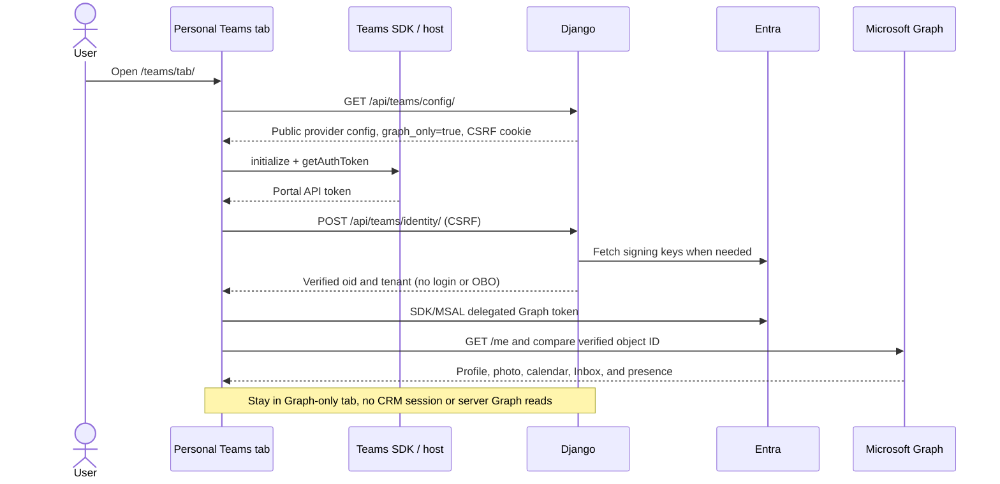
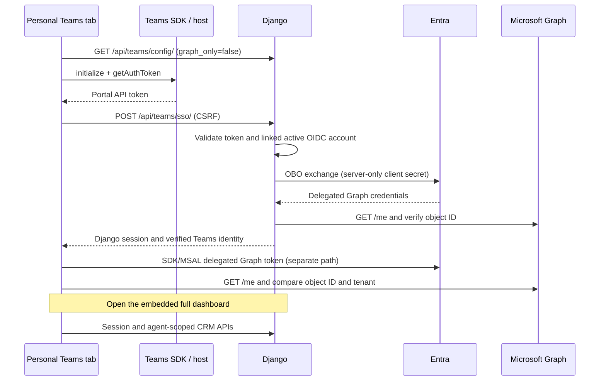

# Teams tabs

Contacts Portal has a personal Microsoft 365 tab and a configurable CRM
customer tab. Both are served by the portal; there is no separate tab server.

## Personal tab

The personal tab opens at `/teams/tabs/personal/`. By default, it opens a Microsoft 365
workspace without signing in to the CRM. Teams SSO verifies the user's Entra
object ID and tenant ID. The Teams SDK then reads the user's profile, photo,
calendar, Inbox, and presence from Microsoft Graph. It requests delegated
`User.Read`, `Calendars.Read`, `Mail.Read`, and `Presence.Read` permissions.

It does not sign in to the CRM. The server validates the signed Teams
SSO token at `/api/teams/identity/` and returns the verified Entra object and
tenant IDs. This identity-only request does not create a Django session, look
up a CRM account, perform OBO, or call Graph from Django.

The browser then starts the Teams Graph SDK with the verified identity and
tenant, gets a delegated Graph token through SDK/MSAL, and verifies the Graph
user ID against the server-verified Teams identity before showing Graph data.
SDK tokens are separate from portal SSO tokens and stay in the SDK's in-memory
cache. The Graph-only startup does not request the Django session, CRM APIs,
`/api/teams/sso/`, or the server-side Graph endpoints.

**Open full dashboard** is an explicit action available in either startup mode.
It obtains a fresh Teams SSO token, validates the identity again and compares it
with the identity already in the tab, then calls `/api/teams/sso/`. That endpoint
performs server-side OBO and creates the CRM session. The user needs an active
OIDC-linked account to complete OBO and a provisioned CRM Agent for CRM data.
Failure leaves the Graph-only workspace open with an error; it does not silently
switch to an existing browser user's session.

Set `TEAMS_GRAPH_ONLY=0` to use the legacy startup: the tab performs OBO at
startup, then initializes its independent SDK Graph client and opens the full
dashboard automatically.

`TEAMS_GRAPH_ONLY` is a Django runtime environment setting. The default is
`true`; accepted true values are `1`, `true`, and `yes` (case-insensitive).
Compose passes the value from the deployment environment; restart or recreate
the portal after changing it. This setting chooses personal-tab startup only:
it does not disable `/api/teams/sso/` or change browser OIDC and local login.

Both startup modes validate signed Teams identity claims, not email or an
unverified user ID from Teams context. Portal SSO tokens are for the portal API
and are never sent to Graph. Graph consent or identity failures are shown to the
user; SDK Graph reads do not fall back to Django Graph reads after SDK startup.

## Configurable customer tab

The configuration page opens at `/teams/config/`. It always uses Teams SSO to
create a CRM session, regardless of `TEAMS_GRAPH_ONLY`. The user selects one of
the customers (companies) linked to their Agent, then saves. Existing selections
are restored when the tab is reconfigured; Save is enabled only after a customer
is selected and the server validates it.

Teams stores the selection in a content URL such as
`/teams/customer/?provider=<provider-id>&customer=<company-id>`. Each viewer
must sign in through Teams SSO for the same provider. The customer selection is
shared, but each viewer sees their own calls, never another Agent's calls.
Customer-list and customer-detail APIs require an authenticated Agent and a
matching Teams SSO provider session. Refresh reloads CRM data. An unknown or
deleted customer shows an error rather than exposing the full directory.

## Graph data and CRM data

Teams tabs use `@microsoft/teams.client` and
`@microsoft/teams.graph-endpoints`; `@microsoft/teams-js` handles portal SSO and
tab configuration. The SDK app is initialized with delegated `User.Read`,
`Calendars.Read`, `Mail.Read`, and `Presence.Read` scopes. The calendar and Inbox
are read-only. The tab reads the signed-in user's default calendar, Inbox,
profile, photo, and Teams presence. Graph-backed profile names and photos cannot
be edited in the portal; email uses Graph `mail`, falling back to
`userPrincipalName`.

The sidebar presence badge polls every 30 seconds and when the page becomes
visible. It is not a webhook or push subscription, so changes normally appear
within 30 seconds plus Graph propagation delay. The portal never changes
presence; errors display an unknown status.

Graph calendar, Inbox, and profile data are separate from CRM calls, appointment
scheduling, KPIs, companies, and contacts, which remain local portal data.
Graph data is not imported into the CRM database.

## Graph implementation boundary

The Teams SDK did not remove the Django Graph implementation. Ordinary browser
Entra OIDC sessions and full-dashboard Teams sessions still use the server-side
Graph client for session/profile responses and browser Graph views. The
Graph-only personal tab does not request those server Graph responses.
See [Teams sign-in and Microsoft Graph](teams-authentication.md) for the token
flows, request routing, and server-side token storage.
